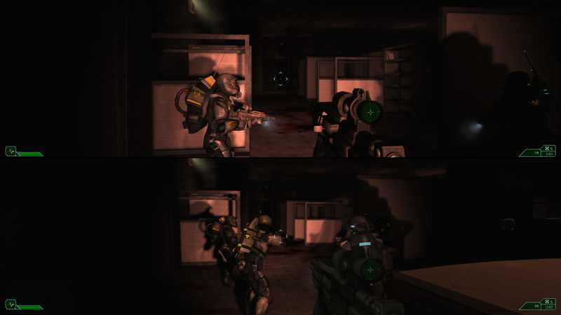
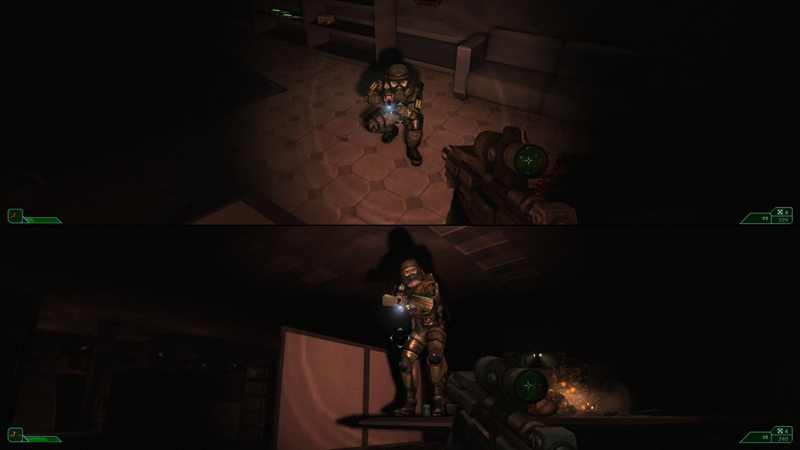
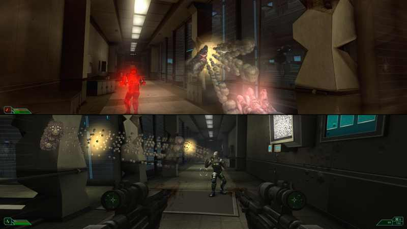

<div align="center">


# AREA 51

## SPLIT-SCREEN CO-OP

**Two players. One PC. The campaign — together.**

An unofficial, experimental local co-op modification for the **Area 51 (2005) PC port**.

[](https://github.com/VortexHyperBeast/Area51-2005-Splitscreen-Coop/actions/workflows/coop-build.yml)
[](https://github.com/VortexHyperBeast/Area51-2005-Splitscreen-Coop/releases/latest)


[**Download v0.95.55 (NexusMods package)**](https://github.com/VortexHyperBeast/Area51-2005-Splitscreen-Coop/releases/download/AREA51_SplitscreenCoop_v0.95.55_Harder_Co-op/AREA51_SplitscreenCoop_v0.95.55_Harder_Co-op.zip) · [**All releases**](https://github.com/VortexHyperBeast/Area51-2005-Splitscreen-Coop/releases) · [**Co-op source branch**](https://github.com/VortexHyperBeast/Area51-2005-Splitscreen-Coop/tree/coop/stage1) · [**Report a bug**](https://github.com/VortexHyperBeast/Area51-2005-Splitscreen-Coop/issues)

</div>

---

<div align="center">


</div>

## The idea

Return to the facility with a partner. This project adds **two-player local split-screen co-op** to the Dreamland-51 PC port of *Area 51*.

Both players share one game session, but each gets their own view of the action:

- **Top-and-bottom split-screen** with an independent camera and HUD for each player.
- **Two local controllers**, with independent movement, aiming, firing, reloading and weapon use.
- **Visible player characters** — each player can see the other in the world.
- **A shared campaign world**, with scripted scenes and cutscenes shown full-screen.

This is a local co-op mod for two players on one PC. It is not online co-op.

## Split-screen showcase

These in-game screenshots show both local players exploring and fighting through the same encounter, each from their own view.

<div align="center">

<table>
<tr>
<td width="50%"></td>
<td width="50%"></td>
</tr>
</table>

<em>Two perspectives. One shared campaign.</em>

</div>

## Project status

<table>
<tr><td><strong>Development stage</strong></td><td>Stage 1 — experimental</td></tr>
<tr><td><strong>Latest public build</strong></td><td>v0.95.55 (build 150)</td></tr>
<tr><td><strong>Current development branch</strong></td><td><a href="https://github.com/VortexHyperBeast/Area51-2005-Splitscreen-Coop/tree/coop/stage1">coop/stage1</a></td></tr>
<tr><td><strong>Players supported</strong></td><td>2 local players</td></tr>
<tr><td><strong>Platform</strong></td><td>Windows 64-bit build</td></tr>
</table>

The build number and mod version are also shown in the top-left corner of the in-game main menu. v0.95.55 (build 150) is the latest public build. The project is still experimental; a successful automated test or level start does not mean that every mission and encounter has been completed in a full human playthrough.

---

## Co-op features

### Two independent players

- Separate player movement, input, camera, HUD, health and damage.
- Both player characters are visible to each other.
- Independent weapon handling, including firing, reloading and switching weapons.
- Co-op enemy-targeting changes allow enemies to consider either player. Behaviour still needs broader campaign playtesting.
- Scripted scenes are synchronized, with both players brought into the shared full-screen scene view.

### Shared inventory, individual health

The co-op rules intentionally keep pickups shared:

| Shared between players | Kept separate |
| --- | --- |
| Weapons | Health |
| Ammunition | Damage taken |
| Grenades | Downed / alive state |
| Equipment and unlocks | Player movement and view |

Collecting a weapon, ammunition, grenade or equipment unlock for one player makes it available to the other as well. Health and damage remain individual.

### Downed and revive system

When one player is incapacitated while their partner is still active, they can be revived instead of immediately forcing a checkpoint restart.

<div align="center">


<em>The downed player can be brought back by their partner.</em>

</div>

**Default co-op rules:**

- Stand near the downed player's body and hold **USE** (X on an Xbox controller) to revive.
- A revive takes **4 seconds**.
- The revived player returns with **35% health**.
- The default bleedout timer is **25 seconds**.
- If both players are down, or the downed player bleeds out, the game returns to the checkpoint.
- A downed player cannot shoot, use grenades, melee or activate mutation.

The core downed body and revive flow has been manually tested. Timer edge cases and every possible campaign situation are still part of ongoing testing.

### Mutation for both players

<div align="center">



<em>Mutation working in split-screen co-op.</em>

</div>

- Either player can mutate independently.
- One player's mutation does not force the other player to mutate.
- Both players can use the mutant form and its attacks.
- Mutated players take **50% damage** by default in co-op.
- Mutant visuals are shown on the player's in-world character as well.

### Character and controller options

Open **Pause Menu → Splitscreen Co-op** to configure the local players.

- Choose a body for Player 1 and Player 2 independently.
- Select from **12 human character appearances**: Hazmat, Spec Ops and Technician styles, with four colour variants per style.
- Swap controller assignments in the pause menu or from the main-menu Co-op Settings page.
- Keyboard and mouse control the first controller slot. With controllers swapped, keyboard and mouse move the player assigned to that slot.

### Campaign and menus

- The main menu keeps **Single Player** and **Splitscreen Co-op** as separate modes.
- Co-op uses its own **Splitscreen P1** and **Splitscreen P2** profiles, separate from the normal single-player profile.
- A co-op-only Level Select provides access to the story missions.
- Both players receive the selected mission's starting loadout.
- The multiplayer arenas are excluded from the co-op story Level Select.

### Co-op difficulty

The main menu now has a dedicated **Co-op Settings** entry (replacing Online). Choose one of three co-op-only enemy and boss health levels:

- **Easy — 100%:** normal single-player enemy and boss health.
- **Normal — 150% (default):** enemies and bosses have 1.5x their normal health.
- **Hard — 200%:** enemies and bosses have 2x their normal health.

The difficulty applies to existing and new Splitscreen Co-op campaigns. Changes take effect immediately. Single Player is not affected. If a custom enemy-health percentage is entered manually in a51_coop.cfg, the menu displays it as **Custom**.

---

## Screens, options and configuration

### Main-menu Co-op Settings

The **Co-op Settings** entry replaces Online in the main menu. Select a row and press **A** or left/right to change it. A help line explains the selected option, and **Back** returns to the main menu.

Available options:

| Option | Choices |
| --- | --- |
| Difficulty | Easy 100% / Normal 150% / Hard 200% enemy and boss health |
| Downed and revive | On / Off |
| Bleed-out time | 15 / 25 / 40 / 60 seconds |
| Revive time | 2 / 4 / 6 seconds |
| Revive health | 25 / 35 / 50 / 100% |
| Controllers | Normal / Swapped |

Changes are saved immediately to a51_coop.cfg beside A51.exe; no restart is required. Settings apply to every Splitscreen Co-op campaign, including existing saves, and do not affect Single Player.

### Pause-menu co-op settings

The **Splitscreen Co-op** page in the pause menu includes controller assignment and separate body selection for P1 and P2. Player-specific Options continue to use the profile belonging to the player who paused.

### Optional configuration file

The in-game menu manages the usual co-op settings automatically. Advanced users can also create or edit a51_coop.cfg beside A51.exe. Add one setting per line:

| Setting | Default | Purpose |
| --- | ---: | --- |
| swap_pads | 0 | 1 swaps the controller assignments |
| downed | 1 | 0 disables the downed/revive system |
| bleedout_seconds | 25 | Time available for a revive |
| revive_seconds | 4 | Time required to complete a revive |
| revive_health_percent | 35 | Health restored after a revive |
| mutant_damage_percent | 50 | Incoming damage while mutated; 100 is normal damage |
| enemy_health_percent | 150 | Enemy and boss health relative to single-player; the menu shows non-standard values as Custom |

Example:

```ini
swap_pads=0
downed=1
bleedout_seconds=25
revive_seconds=4
revive_health_percent=35
mutant_damage_percent=50
enemy_health_percent=150
```

---

## Download and installation

<div align="center">

### [GET THE LATEST CO-OP BUILD](https://github.com/VortexHyperBeast/Area51-2005-Splitscreen-Coop/releases/latest)

</div>

1. Download the current co-op package from the [GitHub Releases page](https://github.com/VortexHyperBeast/Area51-2005-Splitscreen-Coop/releases/latest). The v0.95.55 package is intended for an existing Dreamland-51 PC port installation.
2. Back up your original A51.exe and SHADERS folder.
3. Extract the contents of the co-op ZIP into the Dreamland-51 game folder containing A51.exe. Allow the co-op files to replace the existing executable and shader files.
4. Keep your existing game data in place. The co-op package does **not** include the original Area 51 game data or an asset downloader.
5. Connect your controllers, run A51.exe, and select **Splitscreen Co-op** from the campaign menu.

**Recommended:** two Xbox-compatible controllers. Keyboard and mouse can also be used for one player. With normal controller assignments, keyboard and mouse control Player 1; swapping controllers changes which player uses the first controller slot.

Keyboard shortcut: **T** joins/teleports to the other player; **Tab** performs Use only.

---

## Testing and compatibility

This project uses both manual playtesting and automated two-controller tests.

### Manually checked

Core features have been played and confirmed by the mod author on Windows, including:

- Split-screen gameplay with two controllers.
- Separate Single Player and Splitscreen Co-op menu options and co-op profiles.
- Controller swapping and the P1/P2 character selection page.
- Downed players, reviving and the in-world player bodies.
- Independent mutation, mutant player appearance and mutant attacks.
- Reduced damage while mutated.
- Close-range melee fixes for the Theta encounter.
- Hazmat player face lighting.

### Automated checks

Build 150 (v0.95.55) passed automated checks for normal co-op launch, controller swapping, starting from the Splitscreen Co-op menu, Single Player regression, and a 13-level campaign chain. The fresh-install package check also confirmed that the game starts directly through A51.exe and displays the co-op startup screen.

The earlier build 144 (v0.95.49) campaign sweep started all **19 story maps** in co-op. The automated damage check measured the expected 1.5x enemy health (players dealt two-thirds of their normal damage per hit). The mod author also confirmed the harder enemy health in normal encounters and the Ascension boss.

The bot generally checks only the opening portion of a map, however, so these results do not mean every level, boss, objective, cutscene or late-game checkpoint has been fully completed in a full human playthrough.

### v0.95.55 checks still needing owner confirmation

The automated runner cannot navigate and test every Co-op Settings menu interaction. Please manually check that each row changes as expected, settings persist after restarting, Easy / Normal / Hard behave correctly (including bosses), and the T / Tab and two-player objective marker fixes work in-game.

### Known limitations

- **Two players only.** Three- and four-player split-screen are on hold and are not implemented.
- The campaign is still undergoing compatibility testing. Some later encounters and less common progression paths may need additional fixes.
- Bleedout timing, save/load edge cases and the complete campaign have not all been verified in full manual playthroughs.
- Rendering two full views is more demanding than single-player; performance depends on the PC and graphics settings.

---

## Bug reports

When reporting a problem, please include:

- The build number shown in the main menu.
- The level and what both players were doing when it happened.
- Whether the issue occurs with both controllers or only one.
- The log files below, if they were created.

The game can write these files beside `A51.exe`:

- `a51_local_coop_probe.log` — co-op session diagnostics.
- `a51_crash.txt` and `a51_crash.dmp` — created after a crash.

[**Open an issue on GitHub**](https://github.com/VortexHyperBeast/Area51-2005-Splitscreen-Coop/issues)

---

## Source code and development

The co-op implementation is developed on the **`coop/stage1`** branch. The default `master` branch contains this project landing page; use the co-op branch when browsing or building the co-op source.

Clone the development branch:

```bash
git clone --branch coop/stage1 --single-branch https://github.com/VortexHyperBeast/Area51-2005-Splitscreen-Coop.git
cd Area51-2005-Splitscreen-Coop
```

- [Co-op source code](https://github.com/VortexHyperBeast/Area51-2005-Splitscreen-Coop/tree/coop/stage1)
- [Build and test workflow](https://github.com/VortexHyperBeast/Area51-2005-Splitscreen-Coop/actions/workflows/coop-build.yml)
- [All GitHub releases](https://github.com/VortexHyperBeast/Area51-2005-Splitscreen-Coop/releases)
- [Upstream Dreamland-51 PC port](https://github.com/Source2Spy/area51-pc)

This project builds on the Dreamland-51 PC port, an independent community project. The upstream port and the co-op modifications are separate contributions.

---

## Credits and legal notice

**Split-screen co-op mod:** VortexHyperBeast.

Built on the Dreamland-51 PC port of *Area 51* (2005), with thanks to the upstream project and its contributors.

This is a free, unofficial community modification. It is not affiliated with, endorsed by or sponsored by the original game's developers or publishers. *Area 51*, its original code, game data, assets and trademarks remain the property of their respective rights holders. This repository does not grant a licence to redistribute those materials, and the mod does not include the original game data.
