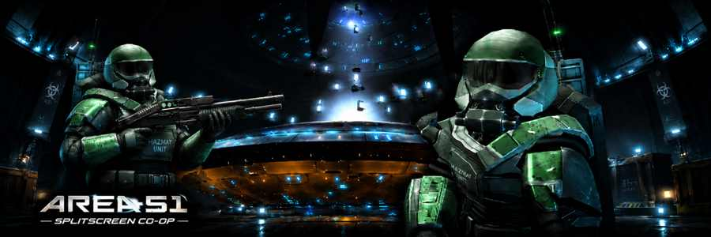
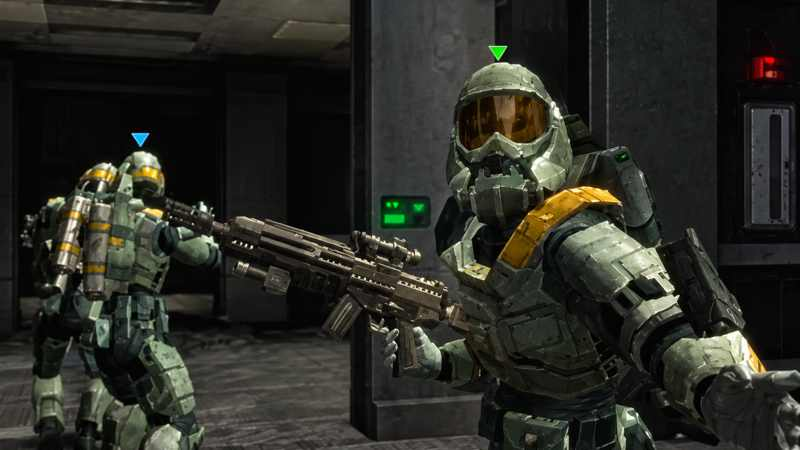
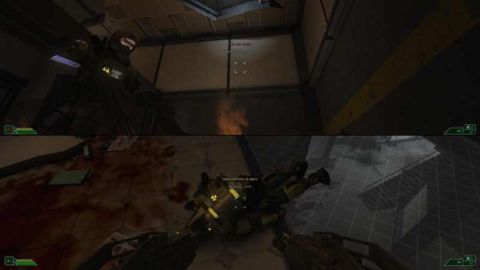

<div align="center">



# AREA 51

## SPLIT-SCREEN CO-OP

**Two players. One PC. The campaign — together.**

An unofficial, experimental local co-op modification for the **Area 51 (2005) PC port**.

[](https://github.com/VortexHyperBeast/area51-pc/actions/workflows/coop-build.yml)
[](https://github.com/VortexHyperBeast/area51-pc/releases/latest)


[**Download the latest build**](https://github.com/VortexHyperBeast/area51-pc/releases/latest) · [**Co-op source branch**](https://github.com/VortexHyperBeast/area51-pc/tree/coop/stage1) · [**Report a bug**](https://github.com/VortexHyperBeast/area51-pc/issues)

</div>

---

<div align="center">



</div>

## The idea

Return to the facility with a partner. This project adds **two-player local split-screen co-op** to the Dreamland-51 PC port of *Area 51*.

Both players share one game session, but each gets their own view of the action:

- **Top-and-bottom split-screen** with an independent camera and HUD for each player.
- **Two local controllers**, with independent movement, aiming, firing, reloading and weapon use.
- **Visible player characters** — each player can see the other in the world.
- **A shared campaign world**, with scripted scenes and cutscenes shown full-screen.

This is a local co-op mod for two players on one PC. It is not online co-op.

## Split-screen showcase

These in-game screenshots show both local players exploring and fighting through the same encounter, each from their own view.

<div align="center">

<table>
<tr>
<td width="50%"></td>
<td width="50%"></td>
</tr>
</table>

<em>Two perspectives. One shared campaign.</em>

</div>

## Project status

<table>
<tr><td><strong>Development stage</strong></td><td>Stage 1 — experimental</td></tr>
<tr><td><strong>Latest published build</strong></td><td>Co-op Stage 1, build 126</td></tr>
<tr><td><strong>Current development branch</strong></td><td><a href="https://github.com/VortexHyperBeast/area51-pc/tree/coop/stage1">coop/stage1</a></td></tr>
<tr><td><strong>Players supported</strong></td><td>2 local players</td></tr>
<tr><td><strong>Platform</strong></td><td>Windows 64-bit build</td></tr>
</table>

The build number and mod version are also shown in the top-left corner of the in-game main menu. The project is still being tested: a successful automated test or level start does not mean that every mission and encounter has been completed in a full human playthrough.

---

## Co-op features

### Two independent players

- Separate player movement, input, camera, HUD, health and damage.
- Both player characters are visible to each other.
- Independent weapon handling, including firing, reloading and switching weapons.
- Enemies can respond to either player; co-op changes also improve target selection for encounters that originally focused on Player 1.
- Scripted scenes are synchronized, with both players brought into the shared full-screen scene view.

### Shared inventory, individual health

The co-op rules intentionally keep pickups shared:

| Shared between players | Kept separate |
| --- | --- |
| Weapons | Health |
| Ammunition | Damage taken |
| Grenades | Downed / alive state |
| Equipment and unlocks | Player movement and view |

Collecting a weapon, ammunition, grenade or equipment unlock for one player makes it available to the other as well. Health and damage remain individual.

### Downed and revive system

When one player is incapacitated while their partner is still active, they can be revived instead of immediately forcing a checkpoint restart.

<div align="center">



<em>The downed player can be brought back by their partner.</em>

</div>

**Default co-op rules:**

- Stand near the downed player's body and hold **USE** (X on an Xbox controller) to revive.
- A revive takes **4 seconds**.
- The revived player returns with **35% health**.
- The default bleedout timer is **25 seconds**.
- If both players are down, or the downed player bleeds out, the game returns to the checkpoint.
- A downed player cannot shoot, use grenades, melee or activate mutation.

The core downed body and revive flow has been manually tested. Timer edge cases and every possible campaign situation are still part of ongoing testing.

### Mutation for both players

<div align="center">


<em>Mutation working in split-screen co-op.</em>

</div>

- Either player can mutate independently.
- One player's mutation does not force the other player to mutate.
- Both players can use the mutant form and its attacks.
- Mutated players take **50% damage** by default in co-op.
- Mutant visuals are shown on the player's in-world character as well.

### Character and controller options

Open **Pause Menu → Splitscreen Co-op** to configure the local players.

- Swap which controller controls Player 1 and Player 2.
- Choose a body for each player independently.
- Select from **12 human character appearances**: Hazmat, Special Forces and Technician styles, with four colour variants per style.

### Campaign and menus

- The main menu keeps **Single Player** and **Splitscreen Co-op** as separate modes.
- Co-op uses its own **Splitscreen P1** and **Splitscreen P2** profiles, separate from the normal single-player profile.
- A co-op-only Level Select provides access to the story missions.
- Both players receive the selected mission's starting loadout.
- The multiplayer arenas are excluded from the co-op story Level Select.

### Co-op balancing

The current co-op build gives enemies and bosses **150% of their normal health by default**, so two players do not simply double the damage output without any adjustment. This can be changed in the co-op configuration file.

---

## Screens, options and configuration

### In-game co-op settings

The **Splitscreen Co-op** page in the pause menu includes controller swapping and separate body selection for P1 and P2.

### Optional configuration file

Create a text file named `a51_coop.cfg` beside `A51.exe`. Add one setting per line:

| Setting | Default | Purpose |
| --- | ---: | --- |
| `swap_pads` | `0` | Set to `1` to swap the two controllers |
| `downed` | `1` | Set to `0` to disable the downed/revive state |
| `bleedout_seconds` | `25` | Time available for a revive |
| `revive_seconds` | `4` | Time required to complete a revive |
| `revive_health_percent` | `35` | Health restored after a revive |
| `mutant_damage_percent` | `50` | Damage taken while mutated; `100` is normal damage |
| `enemy_health_percent` | `150` | Enemy and boss health relative to single-player |

Example:

```ini
swap_pads=0
downed=1
bleedout_seconds=25
revive_seconds=4
revive_health_percent=35
mutant_damage_percent=50
enemy_health_percent=150
```

The in-game pause menu can also swap controllers, so editing the file is not required for that option.

---

## Download and installation

<div align="center">

### [GET THE LATEST CO-OP BUILD](https://github.com/VortexHyperBeast/area51-pc/releases/latest)

</div>

1. Open the [GitHub Releases page](https://github.com/VortexHyperBeast/area51-pc/releases/latest) and download the latest Windows x64 co-op package.
2. Extract the archive and read the `README.txt` included with that exact build. Follow its installation steps; package formats may change between releases.
3. The mod package does **not** contain the original game's data. The currently published Stage 1 setup package asks before downloading the required data pack (approximately 1.5 GB).
4. Connect two controllers and start the game.
5. Choose **Splitscreen Co-op** from the main menu.

**Recommended:** two Xbox-compatible controllers. The controls can be swapped from the in-game co-op settings page.

For a drop-in package, back up the existing `A51.exe` and `SHADERS` folder before replacing them. Keep the original game data in place.

---

## Testing and compatibility

This project uses both manual playtesting and automated two-controller tests.

### Manually checked

Core features have been played and confirmed by the mod author on Windows, including:

- Split-screen gameplay with two controllers.
- Separate Single Player and Splitscreen Co-op menu options and co-op profiles.
- Controller swapping and the P1/P2 character selection page.
- Downed players, reviving and the in-world player bodies.
- Independent mutation, mutant player appearance and mutant attacks.
- Reduced damage while mutated.
- Close-range melee fixes for the Theta encounter.
- Hazmat player face lighting.

### Automated checks

The project includes a test bot that drives two virtual controllers. Automated checks cover controller input and swapping, weapon fire and reload, separate mutation, shared items, pause rendering, down/revive and checkpoint restart flows.

A campaign sweep has started all **19 story maps** in co-op. The bot generally checks only the opening portion of a map, however, so this is not evidence that every level, boss, objective, cutscene or late-game checkpoint has been fully completed with two human players.

### Known limitations

- **Two players only.** Three- and four-player split-screen are on hold and are not implemented.
- The campaign is still undergoing compatibility testing. Some later encounters and less common progression paths may need additional fixes.
- Bleedout timing, save/load edge cases and the complete campaign have not all been verified in full manual playthroughs.
- Rendering two full views is more demanding than single-player; performance depends on the PC and graphics settings.

---

## Bug reports

When reporting a problem, please include:

- The build number shown in the main menu.
- The level and what both players were doing when it happened.
- Whether the issue occurs with both controllers or only one.
- The log files below, if they were created.

The game can write these files beside `A51.exe`:

- `a51_local_coop_probe.log` — co-op session diagnostics.
- `a51_crash.txt` and `a51_crash.dmp` — created after a crash.

[**Open an issue on GitHub**](https://github.com/VortexHyperBeast/area51-pc/issues)

---

## Source code and development

The co-op implementation is developed on the **`coop/stage1`** branch. The default `master` branch contains this project landing page; use the co-op branch when browsing or building the co-op source.

Clone the development branch:

```bash
git clone --branch coop/stage1 --single-branch https://github.com/VortexHyperBeast/area51-pc.git
cd area51-pc
```

- [Co-op source code](https://github.com/VortexHyperBeast/area51-pc/tree/coop/stage1)
- [Build and test workflow](https://github.com/VortexHyperBeast/area51-pc/actions/workflows/coop-build.yml)
- [All GitHub releases](https://github.com/VortexHyperBeast/area51-pc/releases)
- [Upstream Dreamland-51 PC port](https://github.com/Source2Spy/area51-pc)

This project builds on the Dreamland-51 PC port, an independent community project. The upstream port and the co-op modifications are separate contributions.

---

## Credits and legal notice

**Split-screen co-op mod:** VortexHyperBeast.

Built on the Dreamland-51 PC port of *Area 51* (2005), with thanks to the upstream project and its contributors.

This is a free, unofficial community modification. It is not affiliated with, endorsed by or sponsored by the original game's developers or publishers. *Area 51*, its original code, game data, assets and trademarks remain the property of their respective rights holders. This repository does not grant a licence to redistribute those materials, and the mod does not include the original game data.
